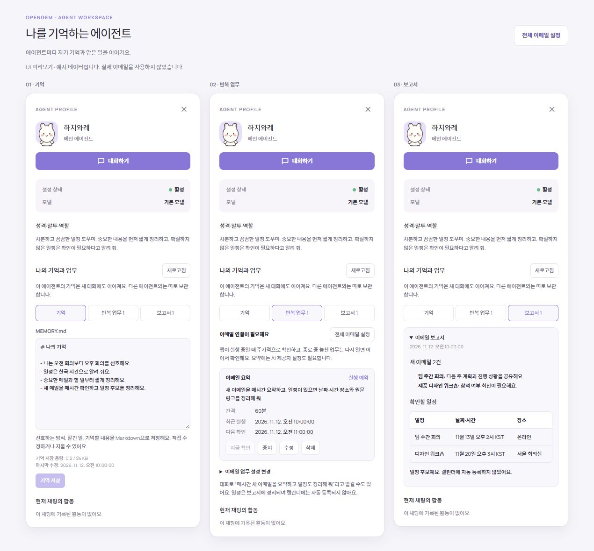
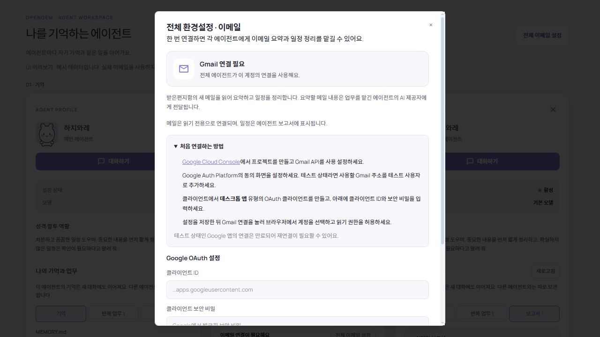

# 에이전트의 성격, 기억과 반복 업무

## 사용 흐름

1. 에이전트 설정의 **성격·말투·역할**에 각 캐릭터가 어떤 태도로 말하고 무엇을 담당하는지 적습니다. 이름이나 캐릭터를 바꿔도 같은 에이전트 ID의 기억은 유지됩니다.
2. 에이전트를 선택해 **개별 대화**를 시작합니다. 예: “나는 짧은 한국어 보고를 좋아하고, 회의 일정은 시간대를 함께 알려 줘.” 일반 대화에서는 개인 기억·반복 업무를 등록하지 않으며 에이전트 선택을 안내합니다.
3. 일반 채팅 모드에서 모델이 사용자의 장기적인 사실·선호·결정·요청을 짧은 Markdown 메모로 저장합니다. 새 세션에서도 이 에이전트의 기억, 최근 대화 20개(최대 12,000자), 최근 보고서를 참고합니다. 다른 에이전트의 내용은 넣지 않습니다.
4. 오른쪽 에이전트 패널의 **MEMORY.md**에서 기억을 확인·수정합니다. 실제 저장은 앱 SQLite의 에이전트별 Markdown 필드이며 프로젝트 폴더에 파일을 만들지 않습니다. 24 KiB를 넘으면 자동 저장을 멈추고 정리를 안내합니다. 기억 편집은 과거 채팅 기록을 삭제하는 동작과 별개입니다.
5. **사용자 메뉴 → Google 연동**에서 Gmail을 연결합니다. [연결 안내](email-setup.md)를 참고합니다.
6. 개별 에이전트에게 “내 이메일을 주기적으로 확인해서 새 메일을 요약하고 일정이 있으면 날짜와 시간도 정리해 줘”라고 요청합니다. 간격을 생략하면 60분이며 “30분마다”처럼 지정할 수 있습니다. 연결이 없어도 업무는 저장하고 설정을 안내합니다.
7. **반복 업무**에서 설명·간격을 편집하거나 일시 중지·재개·지금 확인·삭제할 수 있습니다. 대화에서도 해당 업무의 중지·재개·변경·삭제를 요청할 수 있습니다. 완료 알림의 **실행 기록 보기**는 해당 에이전트의 **보고서** 탭으로 이동합니다.

개발 실행 모드는 성격과 기존 기억을 읽기 전용 참고 자료로 전달합니다. 기억 자동 저장이나 반복 업무 등록은 일반 채팅 모드에서 요청합니다. 자동 기억 관리에는 선택한 모델을 통한 별도 요청이 한 번 추가되므로 모델 사용량이 늘어납니다.

## 현재 지원 범위

- Gmail 받은편지함 읽기 전용. Drive 문서 검색·읽기와 Calendar 일정 조회·검토 후 등록도 전역 Google 연동에서 사용할 수 있습니다. 연결은 앱 전체에서 공유하고 기억·반복 업무·보고서는 모드의 안정적인 ID + 에이전트 ID로 분리합니다.
- 에이전트마다 이메일 요약 업무 1개, 5분~7일 간격. 정확한 시각에 실행하는 cron/시간대 일정은 지원하지 않습니다.
- 업무 생성 이후 새로 수신한 메일부터 확인합니다. 메일 반복 업무는 일정 후보를 원문 링크, 날짜·시간, 시간대, 장소와 함께 보고하고 자동 등록하지 않습니다. Calendar에 등록하려면 별도의 일정 초안을 검토한 뒤 등록 버튼을 누릅니다.
- 앱이 실행 중일 때 15초마다 실행할 업무를 확인합니다. 종료·절전 중에는 실행하지 않으며 재실행 후 밀린 범위를 처리합니다. OS 서비스·시작 프로그램·예약 작업은 추가하지 않습니다.
- 미연결·네트워크·모델 오류를 보고서로 남기고 최대 15분 뒤 재시도합니다. 중지한 업무와 비활성 에이전트는 실행하지 않습니다. 초기 Gmail 연결을 마친 후 즉시 확인하려면 **지금 확인**을 사용합니다.
- 모델에 이메일 본문을 전달하여 요약합니다. 첨부파일은 읽지 않고 긴 본문은 일부만 전달하며 보고서에 이를 표시합니다. 실제 Gmail 로그인과 유료 모델 호출은 자동 테스트에 포함하지 않습니다.
- 보고서는 최신 30개를 유지합니다. 업무를 삭제하면 그 업무의 보고서도 지워집니다. 에이전트를 삭제하면 해당 에이전트의 기억·업무·보고서를 함께 정리합니다.

## 하네스와 확장 지점

| 책임                               | 구현                                                         |
| ---------------------------------- | ------------------------------------------------------------ |
| 에이전트 범위와 백엔드 호출        | src/features/agent/api.ts                                    |
| 기억 회상과 자연어 관리 단계       | src/features/agent/context.ts                                |
| 허용된 관리 동작 검증              | src/features/agent/management.ts                             |
| 반복 실행, 모델 선택, 알림         | src/features/agent/useAgentRoutines.ts, model.ts             |
| 페이지 처리와 중복 제거, 실패 전파 | src/features/agent/digest.ts                                 |
| 능력별 지침                        | src/features/agent/skills/manage-agent.txt, email-digest.txt |
| 기억·업무·실행 임대·결과 저장      | src-tauri/src/commands/agent_workspace.rs                    |
| 전역 이메일 인증과 메일 읽기       | src-tauri/src/commands/email.rs                              |

관리 단계는 현재 사용자 요청과 해당 에이전트의 저장 상태만 받아 제한된 JSON 동작을 결정합니다. 에이전트 ID는 모델이 정하지 않고 현재 대화에서 가져옵니다. 저장 결과를 다음 응답에 전달하므로 실제 저장에 성공한 경우에만 성공했다고 안내합니다. 도구 호출을 지원하지 않는 모델에서도 같은 관리 단계를 사용합니다.

이메일 요약은 도구 없이 실행하며 메일 본문을 외부 자료로 취급합니다. 본문 지시로 메모리나 업무를 수정하지 않습니다. 인증 토큰은 백엔드와 OS 자격 증명 저장소에만 존재하며 프론트엔드·모델·보고서에 전달하지 않습니다.

업무를 실행할 때 SQLite 트랜잭션으로 10분의 실행 임대를 획득합니다. 실행기는 8분 후 중단하며 네이티브 페이지 조회도 시간 제한을 둡니다. 페이지는 같은 종료 시각으로 끝까지 읽고, 모든 요약에 성공한 경우 보고서·메일 ID·체크포인트를 한 트랜잭션으로 저장합니다. 실패·중지·편집·삭제된 실행의 오래된 결과는 확정하지 않습니다.

500개를 넘는 조회는 시간 범위를 나눠 먼저 성공한 구간부터 처리합니다. 이전 성공 시각보다 2분 앞부터 다시 조회하고 저장된 메일 ID로 중복을 제외하여 짧은 검색 반영 지연을 보완합니다. 그보다 오래 지연되어 검색에 나타난 메일까지 보장하는 Gmail history 동기화는 아직 사용하지 않습니다. 계정을 바꾸면 기존 업무를 삭제하고 새 계정에 맞춰 다시 등록하도록 안내하여 서로 다른 메일함의 체크포인트가 섞이지 않게 합니다.

새 이메일 제공자는 백엔드 커넥터의 비밀값 없는 설정/조회 계약을 구현합니다. 새로운 반복 업무 종류는 별도 능력 지침, 검증 가능한 입력, 허용된 도구, 저장된 실행 결과 계약을 추가해 연결합니다. 스케줄러 안에서 일반 채팅의 임의 셸 도구를 재사용하지 않습니다.

## 화면 예시

아래는 실제 컴포넌트에 격리된 예시 데이터를 넣은 미리보기입니다. 비교를 위해 세 탭을 나란히 배치했으며 실제 앱에서는 한 에이전트 패널 안에서 탭을 전환합니다. 실제 이메일은 포함하지 않습니다.

## Drive와 Calendar를 대화에서 사용하기

서비스 연결 후 개별 에이전트의 일반 채팅에서 요청합니다.

- “드라이브에서 프로젝트 기획안을 찾아서 요약해 줘.” — 첫 검색 페이지와 최대 3개 문서의 본문을 읽습니다. 검색 결과가 많거나 형식이 지원되지 않으면 Google 연동의 Drive 파일 탭에서 직접 선택합니다.
- “이번 주 내 캘린더 일정 알려 줘.” — 기기의 현재 시간대를 기준으로 기간을 해석하고 기본 캘린더의 해당 기간을 조회합니다. 다른 캘린더는 Calendar 일정 탭에서 선택할 수 있습니다.
- “내일 오후 2시부터 3시까지 기획 회의 일정을 만들어 줘.” — 날짜·시간·제목을 갖춘 초안을 열며, 사용자가 대상 계정과 내용을 검토해 등록하기 전에는 저장하지 않습니다. 종료 시각 등 필요한 내용이 없으면 추가 정보를 안내합니다.

Google 자료는 조회 결과로만 다루고 그 내용을 요약하는 응답에는 셸·파일 실행 도구를 제공하지 않습니다. 외부 문서가 기억/반복 업무를 수정하거나 일정 등록을 지시할 수 없습니다. 자세한 지원 범위는 [Google Drive·Calendar 안내](google-workspace.md)를 참고합니다.
