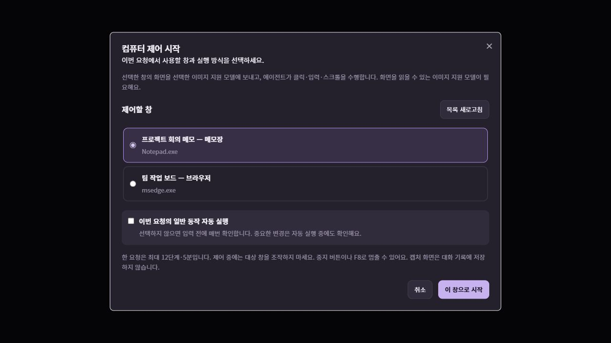
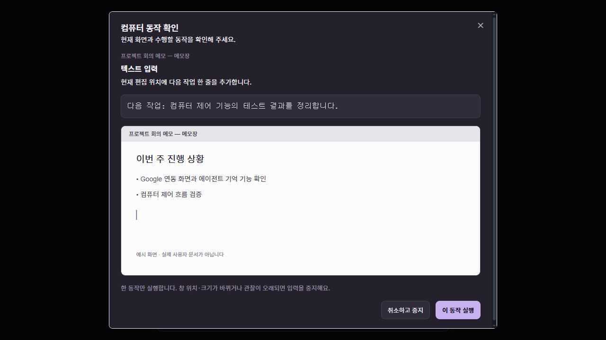

# 컴퓨터 제어

에이전트가 선택한 Windows 앱의 화면을 보고 클릭·텍스트 입력·키 입력·스크롤을 수행합니다. 연결된 API가 있는 Gmail·Drive·Calendar 작업은 해당 커넥터를 우선 사용하고, 화면 조작이 필요한 작업에 컴퓨터 제어를 사용합니다.

## 시작과 중지

1. 이미지 입력을 지원하는 모델과 공급자를 설정합니다. 화면은 현재 선택한 모델 제공자에게 전달됩니다.
2. 개별 에이전트 대화에서 **컴퓨터 제어** 모드를 선택하고 요청을 보냅니다. 이어서 제어할 창을 골라 **이 창으로 시작**을 누릅니다.
3. 기본 모드에서는 에이전트가 제안한 동작을 사용자가 확인한 뒤 실행합니다. 자동 진행은 사용자가 선택했을 때만 적용합니다.
4. 중지 버튼 또는 F8을 누르면 세션을 중단합니다. 늦게 도착한 모델 응답은 중단된 세션에서 실행하지 않습니다.

한 실행은 최대 12단계·5분으로 제한합니다. 시간이 지나거나 대상 창을 다시 확인해야 하면 중단하고 상태를 안내합니다. 전송·삭제·결제·권한 변경 같은 영향이 큰 동작은 자동 진행에서도 실행 전에 확인합니다. 로그인과 민감한 정보 입력은 사용자가 직접 처리합니다.

## 동작 방식

1. 사용자가 선택한 창을 관찰하고 현재 화면과 관찰 ID를 얻습니다.
2. 화면 이미지를 모델에 보내 다음 한 동작을 제안받습니다.
3. 실행기에서 세션·관찰 ID·대상 창·좌표·입력 형식을 검증합니다.
4. 허용한 동작 하나를 실행한 뒤 새 화면을 확인합니다.
5. 결과를 확인하거나 다음 동작을 제안합니다.

좌표는 해당 스크린샷을 기준으로 합니다. 창의 위치·크기·프로세스가 바뀌었으면 이전 좌표로 실행하지 않고 중지합니다. 오래된 관찰은 재관찰·재제안·재검토하며 이전 승인을 재사용하지 않습니다. 창 안의 콘텐츠가 자동으로 변하는 모든 경우를 감지하지는 않으므로 제어 중에는 대상 창을 직접 조작하지 않습니다. 화면 속 문서·웹페이지·알림은 참고 자료이며, 그 안의 문구를 새로운 사용자 지시나 권한으로 취급하지 않습니다.

## 지원 범위와 데이터

- Windows에서 시작하며, 기본 동작은 스크린샷·클릭·텍스트 입력·키 입력·스크롤입니다. Win32 GDI로 전면 창을 캡처하고 SendInput으로 입력합니다. 접근성 트리나 브라우저 DOM 제어는 포함하지 않습니다.
- 대상 창이 최소화되거나 화면 밖에 걸쳐 있거나 다른 창에 가려진 상태는 지원하지 않습니다. 선택한 창을 잠시 전면으로 가져와 캡처·입력하고 원래 창으로 돌아옵니다. 캡처는 최대 1,200만 픽셀·PNG 4 MiB이며 초과하면 창 크기를 줄이도록 안내합니다.
- 관리 권한이 필요한 화면, 잠금 화면, 인증 화면이나 보안 설정 조작을 지원하는 기능은 아닙니다.
- 모델이 화면을 잘못 이해할 수 있으므로 실행 상태와 실제 결과를 확인합니다. 결과를 확인하지 못한 동작을 성공했다고 보고하지 않습니다.
- 스크린샷은 실행 중 메모리에서 사용하며 대화 기록이나 앱 데이터베이스에 저장하지 않습니다. 화면에 보이는 정보는 선택한 모델 제공자에게 전달될 수 있습니다.
- 모델 요청은 PNG/JPEG 이미지 블록을 사용하며, 한 요청의 이미지 합계는 최대 6 MiB입니다. 이미지 URL 문자열만 텍스트로 전달하는 방식은 사용하지 않습니다.
- 이미지 입력을 지원하지 않는 모델이나 공급자는 컴퓨터 제어에 사용할 수 없습니다. 공급자 연결 오류가 발생하면 동작을 진행하지 않고 설정을 안내합니다.
- 일반 대화의 파일·셸 도구 실행과 컴퓨터 제어 실행은 분리합니다.

## 구현 참고

로컬 Codex 컴퓨터 제어 문서에서 대상 창 선택과 **관찰 → 한 동작 → 재관찰** 구조를 참고했습니다. Codex의 비공개 실행 파일이나 번들 런타임을 복사·재배포하거나 그 내부 프로토콜에 의존하지 않습니다. OpenGem의 모델 연결과 Windows 실행 어댑터를 분리하여 다른 운영체제 어댑터를 추가할 수 있도록 구성합니다.

공식 API 문서도 모델 응답과 실제 실행 환경을 별도로 유지하고, 실행 결과를 다시 화면으로 전달하는 구조를 설명합니다. 스크린샷 크기나 잘라낸 영역이 달라지면 입력 좌표를 같은 좌표계로 변환해야 합니다.

- [OpenAI computer use](https://developers.openai.com/api/docs/guides/tools-computer-use)
- [OpenAI computer driver reference](https://developers.openai.com/api/docs/guides/tools-computer-use-sdk-drivers)
- [OpenAI 이미지 입력](https://developers.openai.com/api/docs/guides/images-vision)
- [Anthropic 이미지 입력](https://platform.claude.com/docs/en/build-with-claude/vision)
- [Gemini 콘텐츠·이미지 입력](https://ai.google.dev/api/generate-content)

## 화면 예시와 검증

아래 화면은 실제 컴포넌트에 예시 데이터를 연결한 미리보기이며, 사용자 화면이나 실제 모델 응답은 포함하지 않습니다.

자동 테스트는 제안 형식·좌표·키·단계 상한·중지·만료 관찰·이미지 전송을 검사합니다. Windows 입력 검증은 자체 생성한 테스트 창에서 수행하며 사용자 앱은 조작하지 않습니다. 유료 모델을 통한 전체 자동 작업은 별도로 검증해야 합니다.
