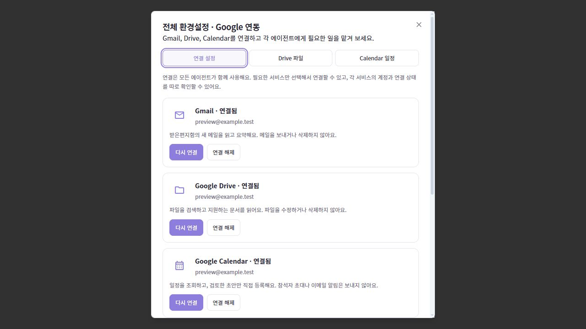
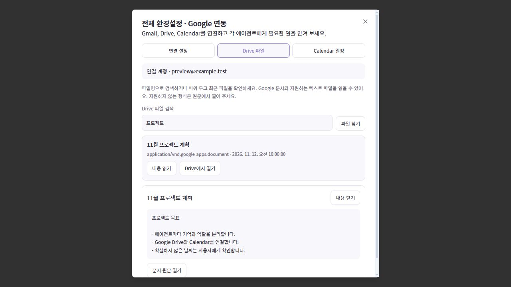
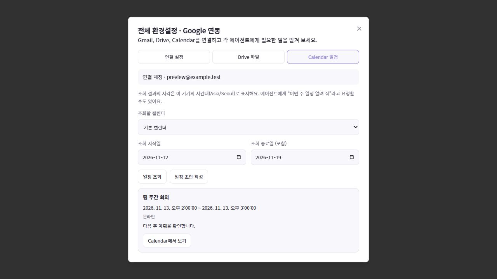
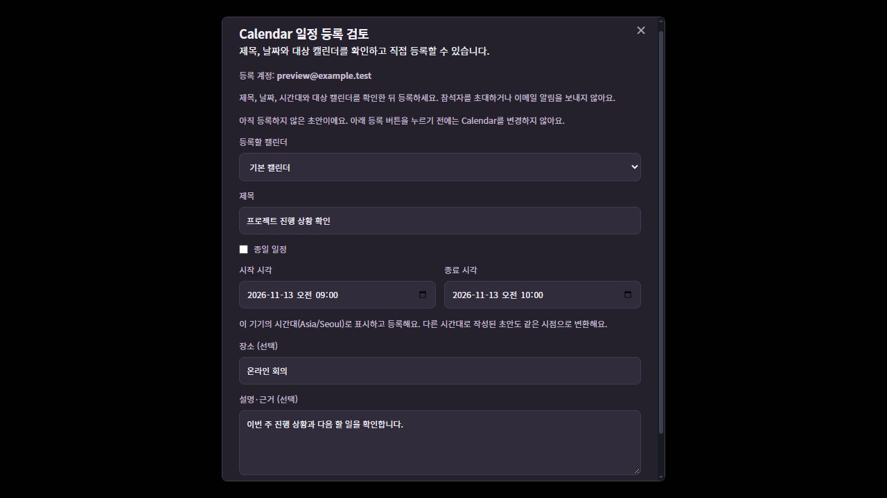

# Google Drive·Calendar 연결과 사용

Google OAuth 클라이언트 설정은 전역으로 공유하며 Gmail·Drive·Calendar는 각각 연결하거나 해제합니다. 서비스마다 연결된 계정과 권한을 표시하므로 Gmail만 연결한 기존 사용자에게 다른 서비스의 권한을 자동으로 추가하지 않습니다.

## 연결 준비

1. Google Cloud 프로젝트에서 사용할 서비스의 API를 켭니다: Gmail API, Google Drive API, Google Calendar API.
2. Google Auth Platform에 데스크톱 앱 OAuth 클라이언트를 만들고 앱의 **Google 연동** 설정에 클라이언트 ID와 보안 비밀을 저장합니다. 테스트 상태인 앱에서는 사용할 계정을 테스트 사용자로 추가합니다.
3. 사용할 서비스의 연결 버튼을 눌러 시스템 브라우저에서 해당 서비스의 권한에 동의합니다. 각 서비스의 연결 계정과 상태를 확인합니다.
4. 서비스가 연결되지 않았거나 권한이 거절된 상태에서는 조회 대신 같은 설정 화면으로 안내합니다.

토큰은 OS 자격 증명 저장소와 백엔드 안에서만 사용합니다. 에이전트·프론트엔드에 토큰을 전달하지 않습니다. 문서나 일정 내용을 대화에서 요약하도록 요청하면 선택한 모델 제공자에게 그 내용이 전달됩니다.

## Google Drive

- 파일 이름·내용 검색과 수정 시각순 목록을 제공합니다. 휴지통 파일은 제외합니다.
- Google Docs와 Slides는 일반 텍스트로 내보내 읽으며, 일반 텍스트·JSON·XML·JavaScript·YAML 파일도 읽을 수 있습니다.
- PDF·이미지·영상·압축 파일·Sheets 전체 통합 문서·바로가기는 본문 읽기를 지원하지 않습니다. 목록의 원문 링크에서 확인합니다.
- 한 페이지는 최대 50개이며 다음 페이지 토큰과 불완전한 검색 여부를 반환합니다. 한 페이지 결과를 전체 Drive의 결과라고 단정하지 않습니다.
- 파일 응답은 최대 2 MiB, 화면에서 읽는 본문은 최대 40,000자입니다. 본문을 줄였거나 UTF-8로 완전히 읽지 못한 경우 일부만 읽었음을 표시합니다. 2 MiB를 넘는 응답은 오류로 반환합니다.
- 에이전트 대화의 자동 조회는 첫 검색 페이지와 최대 3개 문서, 문서당 최대 12,000자로 제한합니다. 일부 결과·읽기 실패·잘림을 구분해 답합니다.
- 업로드·삭제·공유 변경·문서 편집은 수행하지 않습니다.

## Google Calendar

- 읽을 수 있는 캘린더 목록과 지정한 기간의 일정을 조회합니다. 반복 일정은 해당 기간의 개별 일정으로 펼쳐 반환합니다.
- 조회 기간은 시간대 오프셋을 명시한 시작·종료 시각이며 한 번에 최대 366일입니다. 결과에 다음 페이지가 있으면 이어서 읽어야 합니다.
- 일정 등록은 사용자가 초안의 제목·시작·종료·시간대·장소와 대상 계정을 검토한 뒤 등록 버튼을 누르는 경로에서만 수행합니다. 메일 요약이나 Drive 문서 안의 지시가 자동으로 일정을 등록하지 않습니다.
- 날짜·시각 선택기는 기기의 시간대로 표시하며, 다른 시간대의 초안도 같은 시점으로 변환합니다. 등록할 때는 절대 시각으로 저장하며 DST로 존재하지 않는 시각은 다시 선택하도록 안내합니다.
- 종일 일정은 시작 날짜를 포함하고 종료 날짜를 포함하지 않습니다. 예를 들어 11월 12일 하루 일정은 시작 11월 12일, 종료 11월 13일로 전달합니다.
- 초대 대상·회의 링크 생성·공유 설정은 받지 않으며 초대 알림을 보내지 않습니다. 반복 일정 생성·일정 수정·삭제는 현재 지원하지 않습니다.
- 등록 초안은 검토한 Calendar 계정에 묶입니다. 확인 중 연결 계정이 바뀌면 다른 계정에 일정을 등록하지 않고 다시 검토하도록 안내합니다.
- 같은 초안 ID로 재시도하면 같은 Google 일정 ID를 사용합니다. 이전 등록이 성공한 뒤 응답을 받지 못했더라도 재시도로 새 일정을 중복 생성하지 않습니다. 같은 ID의 일정이 다른 내용으로 변경되었거나 삭제된 경우는 성공으로 처리하지 않습니다.

## 백엔드 계약

| 명령                         | 입력                                                                                         | 결과                                        |
| ---------------------------- | -------------------------------------------------------------------------------------------- | ------------------------------------------- |
| list_google_drive_files      | input: query?, pageToken?                                                                    | files, nextPageToken, incompleteSearch      |
| read_google_drive_file       | fileId                                                                                       | id, name, mimeType, content, truncated, url |
| list_google_calendars        | pageToken?                                                                                   | calendars, nextPageToken                    |
| list_google_calendar_events  | input: calendarId?, timeMin, timeMax, query?, pageToken?                                     | events, nextPageToken, timeZone             |
| create_google_calendar_event | input: calendarId, expectedAccountEmail, draftId, title, description?, location?, start, end | 등록된 event                                |

start/end는 dateTime(RFC3339, Z 또는 명시적 오프셋) 또는 date(YYYY-MM-DD) 중 하나와 선택적인 timeZone을 사용합니다. 두 형식을 섞지 않습니다. draftId는 UUID이며 expectedAccountEmail은 모델 출력 대신 사용자가 검토한 연결 상태에서 가져옵니다. 알 수 없는 등록 필드는 거절합니다.

커넥터는 외부 자료를 실행하지 않으며 고정된 Google API 주소로만 요청합니다. 파일 ID와 검색어를 검증·인코딩하고 인증을 붙인 HTTP 리디렉션은 따르지 않습니다. 응답 크기와 시간 제한을 적용하며 공급자 오류의 원문이나 토큰을 사용자 로그에 복사하지 않습니다.

## 공식 참고 자료

- [Drive 파일 목록과 페이지 처리](https://developers.google.com/workspace/drive/api/reference/rest/v3/files/list)
- [Drive 검색어 이스케이프](https://developers.google.com/workspace/drive/api/guides/search-files)
- [Google Workspace 내보내기 형식](https://developers.google.com/workspace/drive/api/guides/ref-export-formats)
- [Calendar 목록](https://developers.google.com/workspace/calendar/api/v3/reference/calendarList/list)
- [일정 조회와 시간대 경계](https://developers.google.com/workspace/calendar/api/v3/reference/events/list)
- [일정 등록과 클라이언트 지정 ID](https://developers.google.com/workspace/calendar/api/v3/reference/events/insert)

## 화면 예시

실제 컴포넌트에 예시 데이터를 연결한 검증 화면입니다. 실제 Google 계정이나 이메일·문서·일정은 포함하지 않습니다.

